# Research: a local pixel engine for generating and editing Elements

Resolves [issue #75](https://github.com/joeuk89/pixel-art/issues/75), part of the v2 map ([#61](https://github.com/joeuk89/pixel-art/issues/61)). Researched 2026-10-24 by a Claude model (Opus 5.5) working in Claude Code with no image service. The capability probe below was run for real: every image on this page was drawn or edited by code the model wrote, rendered locally with Node's `zlib`, and put through the repo's own `gateStill` Quality gate. No paid service was called. The owner judges the art; this file describes what the images show and what the pixel diffs measure.

## Answer in brief

- **Yes, as a set of `pipeline/` scripts, not as a replacement for PixelLab.** Claude cannot output an image; it writes code that draws one ([Anthropic vision docs](https://platform.claude.com/docs/en/build-with-claude/vision): "Claude is an image understanding model only... it cannot generate, produce, edit, manipulate, or create images"). That code is exact: every pixel lands where it is written, on the Palette, with binary alpha. The probe's 7 drawn Elements and 6 edited ones all pass `gateStill`.
- **Jobs a local engine should own in v2:**
  1. **Deterministic edits on any Element**: trim (padded to the schema's multiple of 4), flip, crop, binary alpha, snapping stray colours to the Palette, and small redraws whose position code measures. The probe did each with zero unintended pixels changed.
  2. **Joining overlapping backdrop strips**: a minimum-error cut through the overlap cut seam mismatches from 21 to 3 pixels on the probe. [#63](https://github.com/joeuk89/pixel-art/issues/63) found no inpaint or outpaint endpoint keeps the palette lock, so strips need a local re-palettise and join step anyway.
  3. **Extending tiling textures and checking that they tile**: the probe's wrap check found the library's "tiles left to right" plank wall does not tile cleanly (16 mismatched rows at the wrap against a 7.5 mean between neighbouring columns).
  4. **New Quality gate measurements**: orphan count, wrap-seam mismatch and pane transparency, computed rather than judged by eye.
  5. **The structural kit, provisionally**: room shells (back wall, oblique side walls, floor bands, ceiling strips, plain frames) drawn by parametrised generators at exact sizes with clean 2:1 edges. Geometry is exact; whether the result looks good enough beside PixelLab Elements is the owner's call, and is the doubtful part.
- **Jobs it should not own:**
  - Characterful or shaded props (animals, people, plants, soft furnishings). The probe's cat and teapot read as their subjects but are visibly simpler than the library's PixelLab Elements: hard light bands, stripes that did not come through, and a tail that does not separate from the body.
  - Recolouring finished Elements to another Palette. The probe's nearest-colour mapping merged 3 of 13 colours and turned a red beanbag orange. That repeats why ADR 0001 says "regenerate instead of re-palettise". The one safe recolour is an index-for-index swap to a companion Palette written with matching ramps, and that is the Viewer's lighting pass ([#64](https://github.com/joeuk89/pixel-art/issues/64)), not an Element edit.
  - Automatic orphan cleanup on service art. In the probe, 10 of the 12 pixels the orphan rule replaced were intended detail. Report orphans as a gate warning; never auto-fix them.
  - Inventing new content past an edge (outpainting a skyline). Local code can only repeat or rearrange what is there.
- **Cheapest next step for the doubtful jobs (structural kit, simple props):** the owner looks at the probe images below beside their library counterparts. That costs nothing. If the structural pieces pass, fold one local room shell into the resolution prototype #61 already plans: draw the penthouse's back wall, side walls and floor locally at 384x240 and judge them beside a PixelLab shell. That costs one build session and no generations.
- **No conflict with ADR 0001**, provided the engine draws only with house Palette indices and never edits a Palette; there is a conflict only if the engine re-palettises finished Elements, which this file advises against. **No conflict with ADR 0003**: the engine draws at display size by construction. Two schema limits bite: trimmed props must be padded back to a multiple of 4 (the trimmed lamp is 18x70), and v1 backdrops are fixed at 128x64, so a widened 192 px wall does not validate until v2 changes the backdrop size.

## How Claude sees, and what that means for pixel work

Facts from the [vision docs](https://platform.claude.com/docs/en/build-with-claude/vision), read 2026-10-24:

- Images are read in 28x28-pixel patches: "Each patch is a 28×28-pixel block of the image... An image, therefore, costs ⌈width / 28⌉ × ⌈height / 28⌉ visual tokens." A 64x64 Element at 1x is about 9 patches. At 8x (512x512) it is 361, so each patch covers 3.5 Element pixels.
- Claude 4.7 and later read up to 2,576 px on the long edge before downscaling. An 8x upscale of a 128x128 Element is 1,024 px and arrives unscaled. A 384x240 canvas at 8x is 3,072 px wide and would be downscaled, so view whole v2 Scenes at 4x or 6x.
- Listed limitations: "might hallucinate or make mistakes when interpreting low-quality, rotated, or very small images under 200 pixels"; "coordinate and localization outputs are approximate"; counts "might not always be precisely accurate, especially with large numbers of small objects."

So: look at 8x upscales (the Director already does), use eyes to find things, and use code to measure and place them. The probe tested this. Before measuring, the model wrote down 8 coordinates read by eye from the 8x library window frame (pane corners, mullion and rail outlines) and 2 for the moon in the skyline backdrop. Code then measured the truth. Of the 8 window-frame coordinates, 7 matched exactly and one was off by one pixel (mullion right outline 42, truth 43). The moon estimate (102, 7) was within half a pixel of the centroid of its 11 pixels (102.4, 6.5); that check was a one-off script and is not in the probe code. That is a small sample on clean, high-contrast images; it shows eye reading is good enough to find a feature, not to place pixels. The probe's latch redraw was placed from measured pane positions, not from the eye.

## Prior art

**Published evaluations of LLMs drawing with code.** None tests pixel art at Element sizes with a fixed palette; the closest results agree with the probe:

- SGP-GenBench ([Chen et al., arXiv 2509.05208](https://arxiv.org/abs/2509.05208), NeurIPS 2025) scores SVG generation: "frontier proprietary models substantially outperform open-source models" and "performance correlates well with general coding capabilities."
- SVGenius ([Chen et al., arXiv 2506.03139](https://arxiv.org/abs/2506.03139)) tests SVG understanding, editing and generation over 2,377 queries: "all models exhibit systematic performance degradation with increasing complexity."
- VGBench ([arXiv 2407.10972](https://arxiv.org/abs/2407.10972)) finds models weaker on low-level formats such as SVG than on high-level ones such as TikZ and Graphviz.
- Autoregressive Mosaics ([Nedungadi, Oehmcke and Lüdtke, arXiv 2608.30751](https://arxiv.org/abs/2608.30751), August 2026; eight open-weight models only): all models "reliably" turn a fully specified geometry into code, while open-ended layout varies widely. This matches the probe: structural Elements are fully specified geometry; a curled cat is open-ended layout.
- Pixel Art Bench ([emergentmind.com/pixel-art-bench](https://emergentmind.com/pixel-art-bench)) has LLMs write a 24x24 grid of palette indices with 2 to 10 colours, judged pairwise by another model. The format is close to the probe's mug. The leaderboard showed no scores when read.

**Tools a local engine could drive:**

- **sharp** 0.35.5 is already a dependency. It decodes to raw RGBA, does nearest-neighbour upscales, and trims with `lineArt: true` so 1 px details survive. Pixel-art-specific steps (palette snap, binary alpha) are short code over the raw buffer. [pixel-art-quantisation.md](pixel-art-quantisation.md) verified all of this against the sharp source; `pipeline/lib/strip.ts` already snaps Frame strips to the Palette in Oklab.
- **pngjs** 7.0.0 (MIT, pure JS, last published 2023-02-20, per `npm view`) would do, but sharp makes it unnecessary. The probe used neither: its encoder and decoder are 90 lines over `node:zlib` (`png.ts` below).
- **Aseprite** CLI: `--batch` "runs Aseprite only to process command line options", `--script` runs Lua with `--script-param` values, plus `--palette`, `--color-mode indexed`, `--dithering-algorithm none`, `--trim`, `--crop`, `--scale` and `--sheet` ([CLI docs](https://www.aseprite.org/docs/cli/)). Its Lua `Image:getPixel`/`drawPixel`/`flip` ([API](https://www.aseprite.org/api/image)) cover the same ground as the probe's TypeScript. Aseprite is under its own EULA, not open source ([repo README](https://github.com/aseprite/aseprite)), and is not installed on this machine. It would add a binary dependency to CI for operations that each take under 100 lines of TypeScript, so skip it unless the owner wants to hand-edit `.aseprite` files.
- **Lospec** serves each palette as `.hex`, `.gpl`, `.pal`, `.ase` and 1x/8x/32x PNG ([example](https://lospec.com/palette-list/endesga-32)). `.hex` imports in a few lines, which helps with drafting new house Palettes. House Palettes stay hand-written under ADR 0001.

## Generation probe

Each Element was written one of three ways: a parametrised generator (structural), a hand-typed indexed grid (the mug), or drawing commands with procedural light from the upper left, quantised to a Palette ramp (cat, teapot). Sizes follow the schema (16 to 128, multiples of 4). Results of `gateStill` plus an orphan count (opaque pixels with no same-coloured 8-neighbour):

| Element | Palette | How | Gate | Orphans |
| --- | --- | --- | --- | --- |
| Window frame 64x64, four transparent panes | golden-hour | generator: mitred rails, bevel light, seeded grain | pass | 8 |
| Left side wall 32x96, oblique | golden-hour | generator: vertical planks narrowing 7, 6, 5, 4, 4, 3, 3 px; 2:1 top and bottom edges | pass | 12 |
| Floor band 128x32 | golden-hour | generator: board rows 2 to 8 px tall front-ward, back rows darker | pass | 3 |
| Mug 16x16 | cosy-night | hand-typed 16x16 index grid | pass | 0 |
| Sleeping cat 48x32, first pass | cosy-night | ellipses + Lambert shading on the orange ramp | pass, size warning | 4 |
| Sleeping cat 48x32, second pass | cosy-night | after viewing pass one: rounder head, pointed ears, contour stripes, outlined tail | pass, size warning | 10 |
| Teapot 32x32 | cosy-night | ellipses + Lambert on the blue ramp, one cream glint | pass, size warning | 1 |

The size warnings say the trimmed shape is smaller than the canvas the probe used as its target box. A real run would size the canvas from Scale and `realSize`.

### Structural pieces

| Probe | Library counterpart (PixelLab) |
| --- | --- |
| 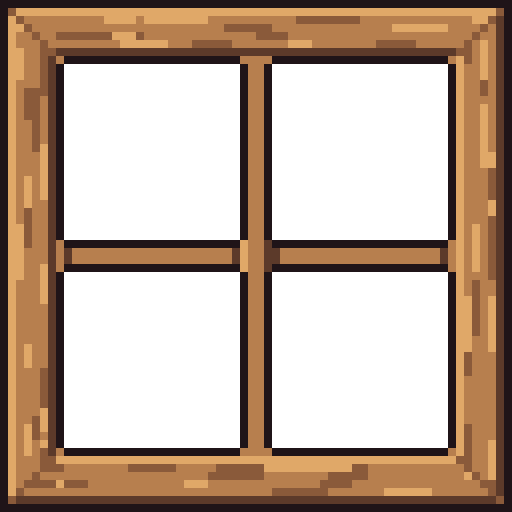 |  |

What the window frame shows: a clean, symmetric frame with mitred corners, a lit top and left bevel, and light and dark grain streaks. The panes are exactly transparent. The mullions are flat 4 px bars with no bevel at the crossing. Next to the library frame (80x80) it has less texture: no knots, no red weathering, no shading inside the rails.

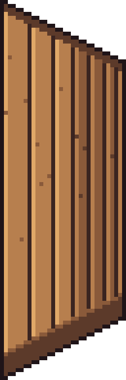

What the side wall shows: an exact trapezoid whose top and bottom edges step 2 px across for every 1 px down. The planks narrow toward the far edge and are darker past the middle. There is a ceiling strip and a skirting board along the bottom. The plank faces are flat colour with a lit left edge and scattered single-pixel knots (most of its 12 orphans).

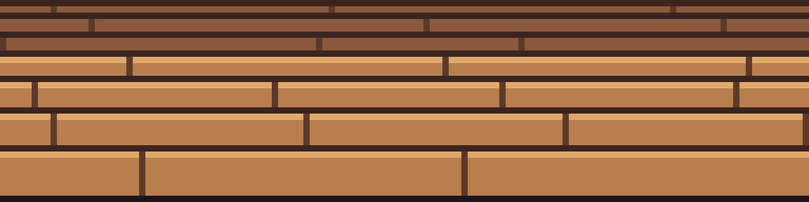

What the floor band shows: board rows getting taller toward the front, darker back rows, staggered end joints. The joints do not converge, so depth comes only from row height and value. Without a room around it, the band could also read as a wall of horizontal boards.

### Props

| Mug 16x16 | Teapot 32x32 |
| --- | --- |
|  | 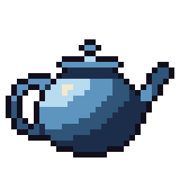 |

The mug reads as a blue mug with a cream rim, dark tea and a small handle tab. The teapot reads as a teapot: lid, knob, spout and loop handle. Its body shading is four concentric bands of the blue ramp curving away from the upper left, with clear steps between bands rather than clusters. The spout is thin.

| Cat, first pass | Cat, second pass | Library Style anchor (PixelLab) |
| --- | --- | --- |
| 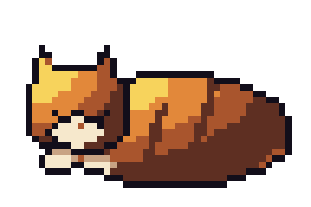 | 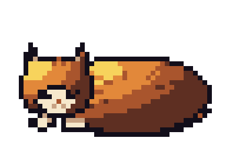 | 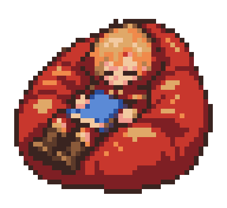 |

The first pass has square-topped ears, a flat head and diagonal light banding across the body. It reads as a cat or a fox. The second pass, made after viewing the first, has pointed ears with inner colour and a face with closed eyes, nose and muzzle. The body is still a lit ellipse with diagonal bands. The stripes came out as a few specks (orphans rose from 4 to 10), and the tail does not separate from the body. Next to the library Style anchor, both passes have far less form, texture and cluster work. This is the ceiling the probe found: the second pass fixed what the first view showed, but a drawn ellipse with banded light does not reach the house style.

## Editing probe

All edits ran on library Elements and were checked by diffing pixels in code.

| Edit | Element | Measured result |
| --- | --- | --- |
| Trim | lamp-floor-linen-drum-01, 24x80 | bounding box 18x70 at (3, 5); 0 opaque pixels lost. 18x70 breaks the schema's multiple-of-4 rule, so a real trim pads to 20x72 |
| Flip | trimmed lamp | flipping twice gives a 0-pixel diff against the input |
| Recolour golden-hour to cosy-night | child-asleep-beanbag-red-01 | 13 colours in, 10 out: 3 merged (`#f08a4b` and `#b77f4e` both became `#e2883a`; `#7e1f24` and `#5c3a2a` both became `#5e2f22`). Alpha unchanged; gate passes |
| Stray cleanup | window-frame-square-wood-01 with 30 injected faults (10 off-Palette near-misses, 10 wrong Palette colours, 10 soft-alpha) | the dirty image fails the gate on alpha and Palette; the cleaned one passes. Only 11 of 30 faults went back to the original colour. The orphan rule replaced 12 pixels, and 10 of those were intended detail |
| Small redraw | window frame | a 4x2 latch centred under the mullion, placed from measured pane positions: 7 pixels changed (the eighth was already that colour), nothing else touched |
| Extend an edge | wall-plank-wood-honey-01, 128x64 | widened to 192 by repeating; the original 128 columns unchanged. Its wrap seam differs in 16 of 64 rows, against a 7.5-row mean between neighbouring columns, so the seam shows |
| Seam repair | two 80 px strips cut from city-skyline-river-night-01 overlapping by 32 px, the second shifted down 1 px to stand in for a separately generated strip | a straight cut leaves 21 mismatched pixels along the seam; a dynamic-programming minimum-error cut leaves 3 |

| Recoloured to cosy-night | Cleanup: dirty | Cleanup: cleaned |
| --- | --- | --- |
| 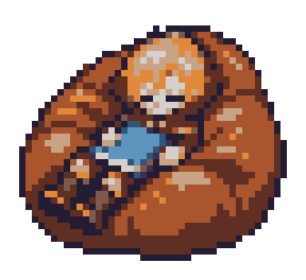 | 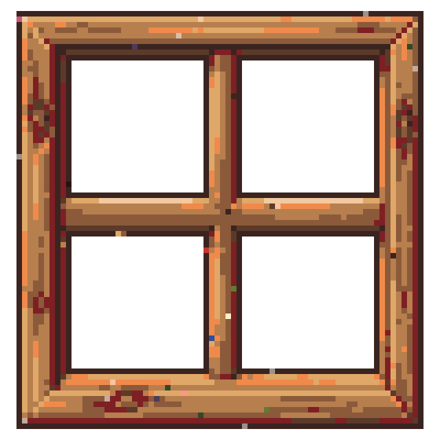 | 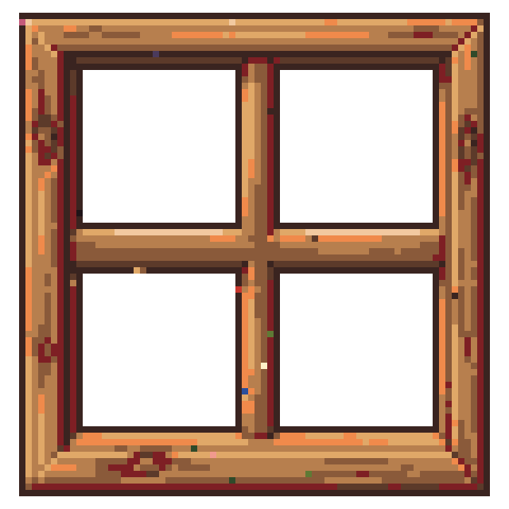 |

The recolour is mechanically clean: every pixel is on cosy-night. But the red beanbag became brown and orange, the hair went grey and cream, and the pink face lost its colour, because cosy-night has no red or pink. The cleanup passes the gate, yet the artwork is not what the artist made: snapping can only find the nearest Palette colour, not the one that was there.

| Latch redraw | Trim and flip |
| --- | --- |
|  | 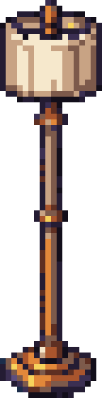 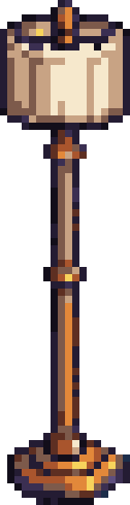 |

The latch sits on the bottom rail under the mullion and is hard to see at this size. The edit was exact; the design of the latch was not good.

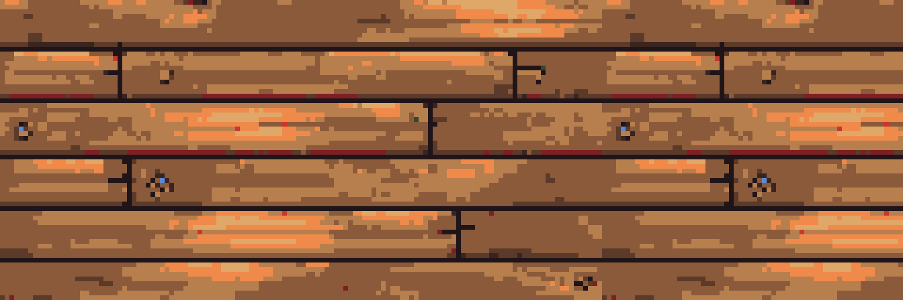

At 192 px, the plank wall shows its repeat: the same knots and joints come back 128 px later.

| Straight cut | Minimum-error cut |
| --- | --- |
| 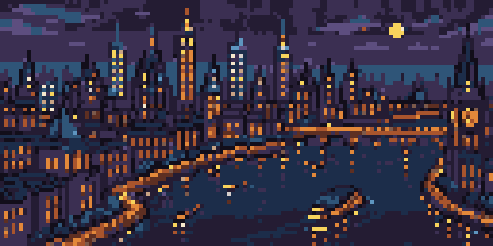 |  |

At 8x the two joins look alike. The 1 px offset shows mostly in the water and the bridge on the right. The minimum-error cut wins on the measure that matters for a seam check.

## Shape of the engine

**Scripts first, no new subagent.** Every job above is deterministic code the Director runs, and `node --test` can test it like the rest of `pipeline/`:

- `pipeline/pixel-ops.ts <op> ...`: trim-and-pad, crop, flip, binarise alpha, snap to Palette (reuse `snapToPalette` from `lib/strip.ts`), join strips with a minimum-error cut, extend by tiling, plus `--measure` for orphans, wrap seam, islands and transparent openings. These are pure functions over `{ width, height, data }`, the type `gateStill` already takes.
- `pipeline/draw-element.ts <scene.json> <placementId> --kit <generator> --params <json>`: runs a structural kit generator (wall, side wall, floor band, ceiling strip, frame) at the derived canvas and writes an Attempt in the same layout as `generate-element` (PNG, `.x8.png`, sidecar with the gate report). `--accept` and `--abandon` stay as they are. The Director then judges the 8x upscale against [rubric.md](../../.claude/skills/director/rubric.md) as for any Attempt.
- **Input**: the Placement's generate block (kind, `realSize`, tags), the Scene's Scale and Palette, and kit parameters in place of a brief (plank widths, edge slope, light side, ramp indices). The Director chooses the parameters. Freehand drawing stays out: the kit generators hold the craft, so results repeat and can be reviewed as code.
- **Output**: an Element PNG on the house Palette at display size, and an Element record with `service: "local"`, `model: "kit/<generator>@<version>"`, `params` set to the kit parameters, `seed` the generator's seed, and `cost` zero. `pipeline/validate.ts` does not restrict `service`, so this validates today (checked in `schema/index.ts`: `service: z.string().min(1)`).
- **Quality gate**: the same `gateStill`, which local output passes by construction for dimensions, alpha and Palette. Add the measured checks from [#62](https://github.com/joeuk89/pixel-art/issues/62) (orphans, and banding for shaded pieces) and a wrap-seam check for `tileX` Placements, then the Director's visual check.
- **Against PixelLab and Retro Diffusion**: complement, not replace. Services keep characterful props, backdrops with invented content, and Frame strips. The local engine owns post-processing and strip joins for every service output, and possibly the structural kit if the owner accepts the look. A subagent with its own skill only makes sense if the owner later wants freehand local props. The cat probe argues against that for now.

## Probe code

All in [local-pixel-engine/](local-pixel-engine/). Run from the repo root with Node 22.18+; outputs land in that folder.

- [png.ts](local-pixel-engine/png.ts): minimal PNG encoder and decoder over `node:zlib`, nearest-neighbour upscale, and the indexed-grid reader.
- [raster.ts](local-pixel-engine/raster.ts): a Palette-index canvas with shape fill, outer and internal outlines, Lambert light quantised to a ramp, and seeded noise.
- [gen.ts](local-pixel-engine/gen.ts): the seven generation probes, each run through `gateStill`: `node docs/research/local-pixel-engine/gen.ts`.
- [edit.ts](local-pixel-engine/edit.ts): the editing probes and the eye-versus-truth measurement: `node docs/research/local-pixel-engine/edit.ts`.

## Coverage note

Not tested: closing a pane that should be transparent (the flood fill that measured the panes would do it, so likely easy); edits on Frame strips; anything at 384x240; Aseprite itself (not installed). The eye-versus-truth check covers 10 coordinates on 2 images (8 on the window frame, 2 on the moon), so take it as a sign, not a measurement of accuracy. The probe was made in one session at modest effort. A dedicated session on the structural kit generators would likely improve their texture; it would not change which jobs are deterministic.
